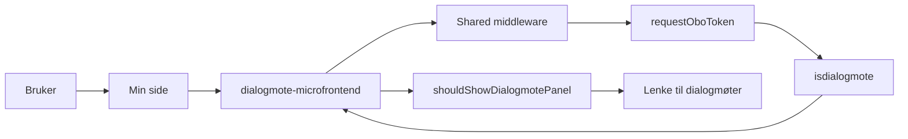
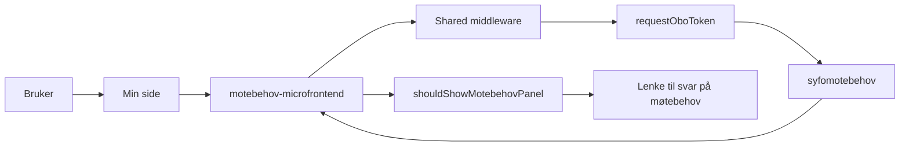

# Dialogmøtearkitektur

`dialogmote` viser status for dialogmøte på Min side. `motebehov` viser panelet der den sykmeldte svarer på om de trenger et dialogmøte. De to er egne mikrofronter med hver sin manifest-id, se [Møtebehov](#møtebehov).

## Flyt

## Hva appen gjør

1. Min side kaller SSR-appen.
2. Shared middleware validerer TokenX-tokenet.
3. `fetchBrev` henter brevdata fra `isdialogmote`.
4. Appen finner siste relevante brev.
5. `shouldShowDialogmotePanel` viser panelet når siste relevante brev er en aktiv innkalling (`INNKALT`, `NYTT_TID_STED` eller `ENDRET`).
6. `resolvePanel` lager panelet med status for svaret og lenke til innkallingen.

## Backend og lenker

| Del                      | Verdi                              |
| ------------------------ | ---------------------------------- |
| Backend                  | `isdialogmote`                     |
| Client ID for OBO        | `ISDIALOGMOTE_CLIENT_ID`           |
| Mål for lenken i panelet | `${DIALOGMOTE_URL}/moteinnkalling` |
| Manifest-id              | `syfo-dialog`                      |

## Møtebehov

`motebehov` er en egen mikrofrontend med manifest-id `syfo-motebehov`. Den henter bare møtebehovstatus fra `syfomotebehov`.

1. Min side kaller SSR-appen.
2. Shared middleware validerer TokenX-tokenet.
3. `fetchMotebehov` henter møtebehovstatus fra `syfomotebehov`.
4. `shouldShowMotebehovPanel` viser panelet når skjematypen er `SVAR_BEHOV`, `visMotebehov` er `true` og brukeren ikke har svart.
5. `resolveMotebehovPanel` lenker til svarsiden for møtebehov.

| Del                      | Verdi                              |
| ------------------------ | ---------------------------------- |
| Backend                  | `syfomotebehov`                    |
| Client ID for OBO        | `SYFOMOTEBEHOV_CLIENT_ID`          |
| Mål for lenken i panelet | `${DIALOGMOTE_URL}/motebehov/svar` |
| Manifest-id              | `syfo-motebehov`                   |

`syfomotebehov` må godta TokenX-klienten `team-esyfo:motebehov-microfrontend` på `/api/v4/arbeidstaker/motebehov`.
