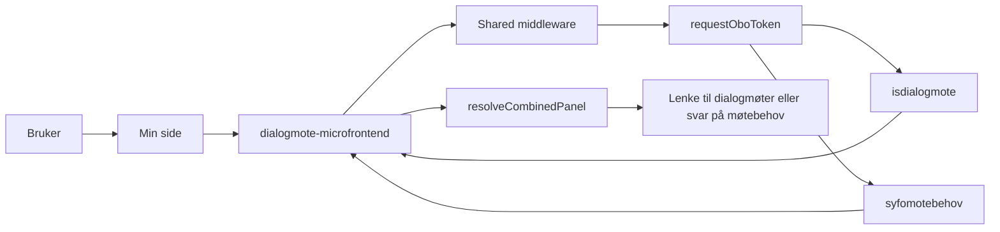
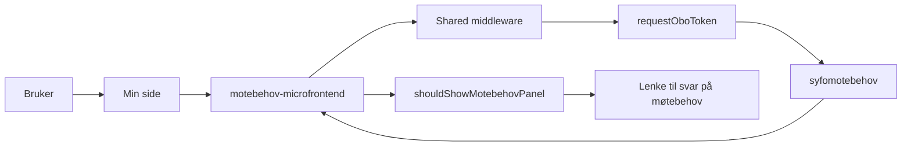

# Dialogmøtearkitektur

`dialogmote` viser status for dialogmøte på Min side. `motebehov` viser panelet der den sykmeldte svarer på om de trenger et dialogmøte. De to er egne mikrofronter med hver sin manifest-id, se [Møtebehov](#møtebehov).

I en overgangsfase håndterer `dialogmote` også møtebehov. Mikrofrontenden henter brevdata fra `isdialogmote` og møtebehovstatus fra `syfomotebehov`, og velger hvilket panel som skal vises ut fra den samlede flyten. Denne grenen fjernes når `esyfovarsel` har flyttet eksisterende møtebehov-brukere over til `syfo-motebehov`, se [Aktivering og deaktivering i esyfovarsel](microfrontend-activation.md#overgangsfase).

## Flyt

## Hva appen gjør

1. Min side kaller SSR-appen.
2. Shared middleware validerer TokenX-tokenet.
3. `fetchBrev` henter brevdata fra `isdialogmote`, og `fetchMotebehov` henter møtebehovstatus fra `syfomotebehov`.
4. Appen finner siste relevante brev og vurderer møtebehovstatus i samme request.
5. `resolveCombinedPanel` prioriterer dialogmøtepanelet når siste relevante brev har typen `INNKALT` eller `NYTT_TID_STED`.
6. Hvis dialogmøtepanelet ikke skal vises, men brukeren skal svare på møtebehov, vises møtebehov-panelet i stedet.

## Backend og lenker

| Del                      | Verdi                                                                       |
| ------------------------ | --------------------------------------------------------------------------- |
| Backend                  | `isdialogmote`, `syfomotebehov`                                             |
| Client ID for OBO        | `ISDIALOGMOTE_CLIENT_ID`, `SYFOMOTEBEHOV_CLIENT_ID`                         |
| Mål for lenken i panelet | `${DIALOGMOTE_URL}/moteinnkalling` eller `${DIALOGMOTE_URL}/motebehov/svar` |
| Manifest-id              | `syfo-dialog`                                                               |

## Møtebehov

`motebehov` er en egen mikrofrontend med manifest-id `syfo-motebehov`. Den henter bare møtebehovstatus fra `syfomotebehov`.

1. Min side kaller SSR-appen.
2. Shared middleware validerer TokenX-tokenet.
3. `fetchMotebehov` henter møtebehovstatus fra `syfomotebehov`.
4. `shouldShowMotebehovPanel` viser panelet når skjematypen er `SVAR_BEHOV`, `visMotebehov` er `true` og brukeren ikke har svart.
5. `resolveMotebehovPanel` lenker til svarsiden for møtebehov.

| Del                      | Verdi                              |
| ------------------------ | ---------------------------------- |
| Backend                  | `syfomotebehov`                    |
| Client ID for OBO        | `SYFOMOTEBEHOV_CLIENT_ID`          |
| Mål for lenken i panelet | `${DIALOGMOTE_URL}/motebehov/svar` |
| Manifest-id              | `syfo-motebehov`                   |

`syfomotebehov` må godta TokenX-klienten `team-esyfo:motebehov-microfrontend` på `/api/v4/arbeidstaker/motebehov`.
