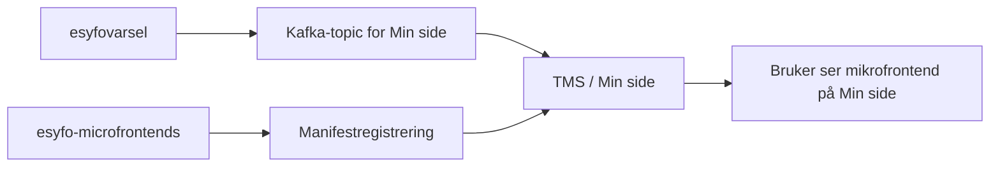

# Aktivering og deaktivering i esyfovarsel

En mikrofrontend vises bare når to ting er på plass:

1. dette repoet har deployet appen og registrert den i manifestet
2. `esyfovarsel` har sendt en enable-melding for brukeren

Dette repoet eier bygg, deploy og manifest. `esyfovarsel` eier om en bruker faktisk skal se panelet.

## Ansvarsdeling

| Ansvar                                               | Repo                   |
| ---------------------------------------------------- | ---------------------- |
| Bygge Astro-app, laste opp assets og deploye SSR-app | `esyfo-microfrontends` |
| Registrere `manifest_id` og URL i TMS-manifestet     | `esyfo-microfrontends` |
| Avgjøre om en bruker skal se en mikrofrontend        | `esyfovarsel`          |
| Sende enable- og disable-meldinger til Min side      | `esyfovarsel`          |

## Hvordan flyten virker

## Meldingsformat

Min side bruker enable- og disable-meldinger på Kafka-topicet for mikrofronter. Selve meldingsformatet er dokumentert i TMS-dokumentasjonen:

- [Aktivere og deaktivere microfrontends](https://navikt.github.io/tms-dokumentasjon/microfrontend/)

## Manifest-id-er i dette repoet

| Mikrofrontend  | Manifest-id           |
| -------------- | --------------------- |
| dialogmøte     | `syfo-dialog`         |
| møtebehov      | `syfo-motebehov`      |
| aktivitetskrav | `syfo-aktivitetskrav` |
| meroppfølging  | `syfo-meroppfolging`  |

`esyfovarsel` må bruke samme `microfrontend_id` som manifestet i dette repoet.

## Dialogmøte og møtebehov

Dialogmøte og møtebehov har hver sin mikrofrontend og hver sin manifest-id. Hver id styres av én produsent:

| Manifest-id      | Mikrofrontend              | Styres av hendelser fra |
| ---------------- | -------------------------- | ----------------------- |
| `syfo-dialog`    | `dialogmote-microfrontend` | `isdialogmote`          |
| `syfo-motebehov` | `motebehov-microfrontend`  | `syfomotebehov`         |

Med én produsent per id kan synligheten styres med enkle enable- og disable-meldinger, der siste melding vinner. Tidligere delte de to produsentene `syfo-dialog`, og `esyfovarsel` måtte flette tilstanden deres.

### Overgangsfase

Til møtebehov-grenen er fjernet fra dialogmøte-appen, kan `dialogmote-microfrontend` fortsatt vise møtebehov-panelet via `resolveCombinedPanel`. Det dekker brukere som har `syfo-dialog` aktivert bare på grunn av møtebehov, til `esyfovarsel` har flyttet dem over til `syfo-motebehov`. Rekkefølgen er:

1. Deploy `motebehov-microfrontend` og gi den tilgang i `syfomotebehov`.
2. Deploy `esyfovarsel` med egen mapping for `syfo-motebehov` og kjør backfill.
3. Fjern møtebehov-grenen fra dialogmøte-appen.

Her kan brukere se to paneler eller ingen:

- Steg 2 før steg 1 gir ingen panel: nye møtebehov aktiverer `syfo-motebehov` før appen og manifestet finnes.
- Mellom steg 2 og backfill kan en bruker som allerede har `syfo-dialog` for møtebehov, og som får en ny møtebehov-hendelse, få begge id-ene aktivert. Da viser begge appene møtebehov-panelet. Backfill deaktiverer `syfo-dialog` for disse brukerne.
- Steg 3 før backfill gir ingen panel for brukere som bare har `syfo-dialog` aktivert for møtebehov.

`syfomotebehov` ferdigstiller møtebehov-varselet når et dialogmøte blir innkalt, og da deaktiveres `syfo-motebehov`. En bruker ser derfor normalt ikke dialogmøte og møtebehov samtidig.

## Det `esyfovarsel` gjør i dag

`esyfovarsel` har egne services for å oppdatere synlighet for:

- `syfo-dialog`
- `syfo-motebehov`
- `syfo-aktivitetskrav`
- `syfo-meroppfolging`

Disse serviceklassene oppretter `MinSideRecord` med `@action`, `ident` og `microfrontend_id`, og sender dem videre til Min side-topicet.

## Hva deaktivering betyr

Deaktivering skjer når `esyfovarsel` sender en disable-melding, eller når synlighetsperioden går ut og tjenesten lukker mikrofrontenden automatisk. Da slutter Min side å vise panelet for brukeren, selv om appen fortsatt er deployet og registrert i manifestet.
